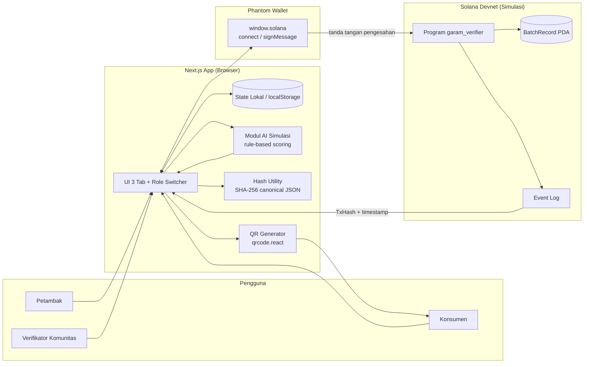
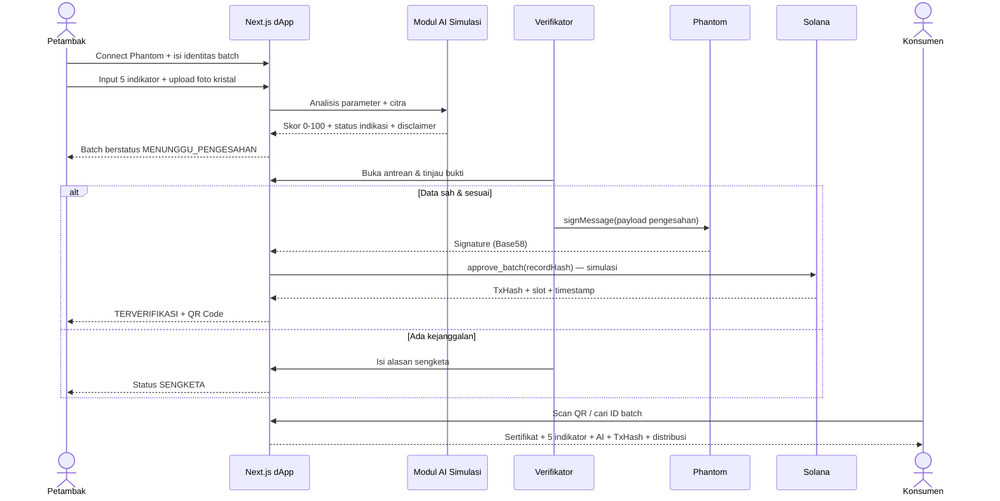
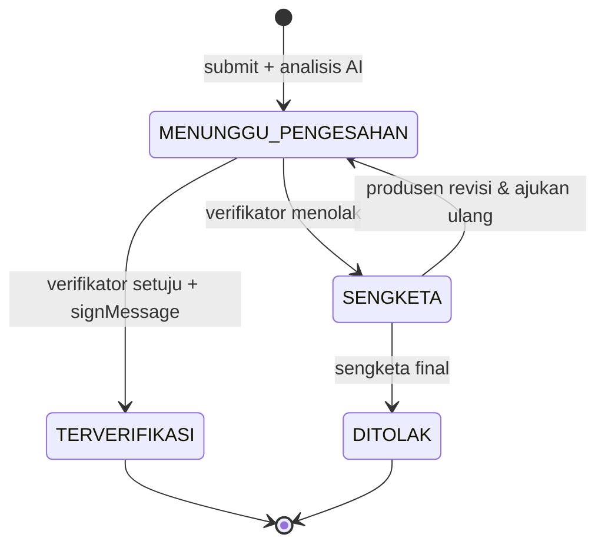

# SKEMA SISTEM — Verifikasi Keaslian Garam Lokal
### Pengetahuan Lokal + AI + Blockchain (Solana)

Dokumen ini adalah rancangan teknis sebelum implementasi, disusun dari `uts.txt` dan `prompting.txt`.

---

## 1. Ringkasan Sistem

Aplikasi dApp satu halaman (Next.js App Router) dengan **3 peran** dan **3 tab**:

| Peran | Tab | Tugas utama |
|---|---|---|
| Petambak Garam (Produsen) | Tab 1 | Input batch + 5 indikator + foto → analisis AI → ajukan verifikasi |
| Verifikator Komunitas | Tab 2 | Tinjau data + hasil AI → sahkan (`signMessage`) atau sengketa |
| Konsumen / Publik | Tab 3 | Cari ID batch / scan QR → lihat sertifikat digital + bukti blockchain |

**Prinsip kerja:** AI hanya memberi **indikasi awal**, komunitas yang **mengesahkan**, blockchain menjaga **integritas catatan setelah disahkan**.

---

## 2. Arsitektur Sistem



### Pembagian on-chain vs off-chain

| Data | Lokasi | Alasan |
|---|---|---|
| ID batch, hash rekaman, wallet petambak, wallet verifikator, timestamp, status, skor AI | **On-chain** | Bukti integritas & pengesahan |
| Riwayat distribusi (hash per tahap) | **On-chain** | Ketertelusuran append-only |
| Detail 5 indikator, foto, narasi AI, dokumen, data pribadi | **Off-chain** (state lokal) | Murah, privat; cukup hash-nya on-chain |
| File foto asli | Off-chain (data URL) | Tidak perlu diunggah ke chain |

> `recordHash = SHA-256(canonical JSON batch)` — hash inilah yang dicatat on-chain dan ditampilkan di QR/sertifikat.

---

## 3. Alur End-to-End



### State machine status batch



---

## 4. Aktor & Hak Akses

| Aksi | Petambak | Verifikator | Konsumen | Smart Contract |
|---|---|---|---|---|
| Connect Phantom | ✅ | ✅ | opsional | — |
| Buat batch + input indikator | ✅ | — | — | menolak jika batch ID duplikat |
| Trigger analisis AI | ✅ | ✅ (lihat) | — | — |
| Setujui & catat blockchain | — | ✅ | — | hanya wallet verifikator terdaftar |
| Sengketa / tolak | — | ✅ | — | status harus MENUNGGU |
| Revisi setelah sengketa | ✅ | — | — | membuat record_hash baru |
| Lihat sertifikat terverifikasi | ✅ | ✅ | ✅ | baca publik |
| Ubah data setelah disahkan | ❌ | ❌ | ❌ | immutable (program menolak) |

**Role Switcher** hanya untuk simulasi demo; otorisasi sebenarnya tetap ditentukan wallet yang connect.

---

## 5. Skema Data (TypeScript)

```ts
export type Role = "produsen" | "verifikator" | "konsumen";

export type BatchStatus =
  | "MENUNGGU_PENGESAHAN"
  | "TERVERIFIKASI"
  | "SENGKETA"
  | "DITOLAK";

export type WarnaKristal = "putih_bersih" | "putih_tulang";
export type TeksturButiran = "kasar_krosok" | "halus_merata";
export type MetodeProduksi = "kristalisasi_tradisional" | "meja_geomembran";

export interface IndikatorVerifikasi {
  warnaKristal: WarnaKristal;
  teksturButiran: TeksturButiran;
  kadarAirPersen: number;        // moisture meter, 0–100
  salinitasPersen: number;       // salinometer/refraktometer, 0–100
  nomorDokumen: string;          // nomor surat kelompok tani / izin garam
  namaKelompok: string;
  fotoKristalDataUrl?: string;   // preview + input analisis citra
}

export interface AIResult {
  skor: number;                  // 0–100
  status:
    | "Sesuai Standar Garam Lokal"
    | "Indikasi Pencampuran Garam Rafinasi";
  subSkor: {
    warna: number;
    tekstur: number;
    kadarAir: number;
    salinitas: number;
    dokumen: number;
    citra: number;               // sinyal gabungan dari foto
  };
  ringkasan: string;
  disclaimer: string;
  dianalisisPada: string;        // ISO timestamp
  model: string;                 // "simulasi-rule-based-v1"
}

export interface BlockchainProof {
  network: "solana-devnet";
  txHash: string;                // signature Base58 (simulasi)
  slot?: number;
  recordHash: string;            // SHA-256 canonical JSON
  walletPetambak: string;
  walletVerifikator: string;
  disahkanPada: string;          // ISO timestamp
  programId: string;
}

export interface RiwayatDistribusi {
  tahap: "tambak" | "gudang_koperasi" | "distributor" | "konsumen";
  lokasi: string;
  waktu: string;                 // ISO timestamp
  aktor: string;
  catatan?: string;
}

export interface BatchGaram {
  id: string;                    // contoh: GRM-AMED-2026-001
  namaTambak: string;
  lokasi: string;
  tanggalPanen: string;          // YYYY-MM-DD
  metodeProduksi: MetodeProduksi;
  indikator: IndikatorVerifikasi;
  ai: AIResult;
  status: BatchStatus;
  walletPetambak?: string;
  catatanVerifikator?: string;
  alasanSengketa?: string;
  blockchain?: BlockchainProof;
  distribusi: RiwayatDistribusi[];
  dibuatPada: string;
  diperbaruiPada: string;
}
```

### Contoh record (batch terverifikasi)

```json
{
  "id": "GRM-AMED-2026-001",
  "namaTambak": "Tambak Garam Amed",
  "lokasi": "Amed, Karangasem, Bali",
  "tanggalPanen": "2026-09-12",
  "metodeProduksi": "kristalisasi_tradisional",
  "indikator": {
    "warnaKristal": "putih_bersih",
    "teksturButiran": "kasar_krosok",
    "kadarAirPersen": 7.9,
    "salinitasPersen": 94.6,
    "nomorDokumen": "IG-SALT-BALI/041/2026",
    "namaKelompok": "Kelompok Petambak Amed"
  },
  "ai": {
    "skor": 95,
    "status": "Sesuai Standar Garam Lokal",
    "disclaimer": "Hasil AI hanya indikasi awal dan memerlukan pengesahan komunitas sebelum dicatat ke blockchain.",
    "dianalisisPada": "2026-09-20T08:30:00.000Z",
    "model": "simulasi-rule-based-v1"
  },
  "status": "TERVERIFIKASI",
  "blockchain": {
    "network": "solana-devnet",
    "txHash": "4xK9...contohSignatureBase58",
    "recordHash": "a1b2c3d4e5f6...64hex",
    "walletPetambak": "7xKX...",
    "walletVerifikator": "B4nD...",
    "disahkanPada": "2026-09-20T09:12:00.000Z",
    "programId": "GaramVer1...simulasi",
    "mode": "simulasi"
  }
}
```

---

## 6. Aturan Verifikasi 5 Indikator

### 6.1 Tabel pengetahuan lokal (wajib UTS)

> **Dasar dokumentasi:** tabel ini disusun dari literatur dan dokumen publik, **bukan wawancara**. Rincian sumber, kutipan, dan batas klaim ada di [`DOKUMENTASI-GARAM.md`](./DOKUMENTASI-GARAM.md). Istilah seperti “putih tulang” dan “krosok” tidak berlaku seragam di semua daerah; keduanya adalah hipotesis lokal yang perlu validasi lapangan.

| Pengetahuan lokal | Indikator | Metode pemeriksaan | Dukungan AI | Bukti yang dicatat di blockchain |
|---|---|---|---|---|
| Warna garam lokal bervariasi: Amed putih cerah; garam tradisional Cirebon bisa putih kusam; “putih tulang” adalah istilah lokal yang belum terverifikasi literatur | Warna kristal | Observasi visual + foto | Sinyal warna dari hash foto (simulasi deterministik) + input visual | Hash rekaman + skor warna |
| Tekstur bervariasi: krosok/kasar umum di Madura, tetapi Amed berbutir kecil–sedang dan lunak; tekstur bukan penentu tunggal | Tekstur & ukuran butiran | Observasi visual & raba | Sinyal tekstur dari hash foto (simulasi) + input visual | Hash rekaman + skor tekstur |
| Garam yang dikeringkan cukup tidak menggumpal; acuan SNI kadar air maks. 7% | Kadar air | Moisture meter (%) | Interpolasi skor dari parameter | Nilai % + hash rekaman |
| Rasa asin kuat adalah petunjuk sensorik; acuan SNI NaCl min. 94% (Amed 95–96%) | Salinitas / NaCl | Salinometer / refraktometer / uji lab (%) | Interpolasi skor dari parameter | Nilai % + hash rekaman |
| Dokumen asal/IG membantu ketertelusuran; tidak semua garam lokal ber-IG | Klaim dokumen asal | Verifikasi nomor surat/IG ke penerbit | Pencocokan format nomor (belum verifikasi registry) | Hash dokumen + wallet pengesah |

### 6.2 Ambang & bobot

| # | Indikator | Jenis | Aturan | Bobot |
|---|---|---|---|---|
| 1 | Warna kristal | Observasi | `putih_tulang` = 100; `putih_bersih` = 85 (tetap wajar) | 15% |
| 2 | Tekstur butiran | Observasi | `kasar_krosok` = 100; `halus_merata` = 50 (sinyal rafinasi) | 20% |
| 3 | Kadar air | Alat ukur | ≤ 7% = 100; 7–10% = `100 − ((v−7)/3)×40`; > 10% = `max(20, 60−(v−10)×8)` | 20% |
| 4 | Salinitas / NaCl | Alat ukur | ≥ 94% = 100; 90–<94% = `60 + ((v−90)/4)×39`; < 90% = `max(20, 60−(90−v)×8)` | 25% |
| 5 | Dokumen asal | Dokumen | Keduanya kosong = 20; salah satu kosong = 40; nomor ≥ 8 karakter dan mengandung `/`, `-`, atau `.` = 100; format lain = 70 | 20% |

> Ambang mengacu pada SNI 3556:2016 garam konsumsi (kadar air maks. 7%, NaCl min. 94%). Sejak 2025, SNI 3556:2024 diberlakukan wajib melalui Permenperin 16/2025; prototipe belum memverifikasi ulang angkanya terhadap versi 2024. Untuk prototipe, nilai ini dapat disesuaikan setelah validasi komunitas.
>
> Aturan warna dan tekstur di atas adalah **penyederhanaan demo**, bukan aturan universal. Lihat catatan validasi dan variasi daerah di [`DOKUMENTASI-GARAM.md`](./DOKUMENTASI-GARAM.md).

### 6.3 Rumus skor AI

```text
skor = 0.15·W + 0.20·T + 0.20·A + 0.25·S + 0.20·D

W = 0.5·skorInputWarna + 0.5·skorCitraWarna
T = 0.5·skorInputTekstur + 0.5·skorCitraTekstur
A = interpolasi(kadarAir)
S = interpolasi(salinitas)
D = skorDokumen
```

- **Status:** `skor ≥ 75` → *Sesuai Standar Garam Lokal*; `skor < 75` → *Indikasi Pencampuran Garam Rafinasi*.
- **Citra:** prototipe memakai simulasi deterministik dari hash file foto (input sama → hasil sama), sehingga demo dapat diulang. Pada sistem nyata, ini diganti model CNN/vision API.
- **Disclaimer wajib** ditampilkan di UI dan disimpan di record:
  > “Hasil AI hanya merupakan indikasi awal dan memerlukan pengesahan komunitas sebelum dicatat ke blockchain.”

---

## 7. Rancangan Smart Contract (Solana / Anchor)

### 7.1 Akun

```rust
#[account]
pub struct BatchRecord {
    pub batch_id: [u8; 32],      // hash ID batch
    pub record_hash: [u8; 32],   // SHA-256 canonical JSON off-chain
    pub producer: Pubkey,
    pub verifier: Pubkey,
    pub harvest_ts: i64,
    pub approved_ts: i64,
    pub ai_score: u8,
    pub status: u8,              // 0=pending, 1=verified, 2=disputed, 3=rejected
    pub metadata_uri: String,    // maks. 200 karakter (IPFS/Arweave)
    pub bump: u8,
}

#[account]
pub struct VerifierRegistry {
    pub authority: Pubkey,
    pub aktif: bool,
}

#[account]
pub struct CustodyEvent {
    pub batch: Pubkey,
    pub seq: u32,
    pub stage: u8,               // 0=tambak, 1=gudang, 2=distributor, 3=konsumen
    pub location_hash: [u8; 32],
    pub timestamp: i64,
    pub actor: Pubkey,
}
```

**PDA seeds**
- `BatchRecord`: `["batch", producer, batch_id]`
- `VerifierRegistry`: `["verifier", authority]`
- `CustodyEvent`: `["custody", batch, seq.to_le_bytes()]`

### 7.2 Instruksi

| Instruksi | Signer | Aturan yang ditegakkan |
|---|---|---|
| `create_batch(batch_id, record_hash, harvest_ts, metadata_uri)` | Petambak | Batch ID unik; wallet = pembuat |
| `approve_batch(record_hash)` | Verifikator terdaftar | Status harus `pending`; hash harus sama; tidak bisa dua kali |
| `dispute_batch(reason_hash)` | Verifikator terdaftar | Status harus `pending`; alasan disimpan sebagai hash |
| `transfer_custody(stage, location_hash, ts)` | Kustodian saat ini | Append-only; urutan tahap valid |
| `register_verifier(authority)` | Admin komunitas | Hanya admin; untuk demo bisa di-seed |

### 7.3 Event

`BatchCreated`, `BatchApproved`, `BatchDisputed`, `CustodyTransferred` — masing-masing membawa `batch`, `actor`, `timestamp`, `record_hash`.

### 7.4 Mode prototipe (yang akan diimplementasikan)

1. **Phantom `signMessage`** benar-benar dipanggil saat verifikator mengesahkan (sesuai `prompting.txt`).
2. `txHash` = signature Base58 hasil `signMessage` (simulasi transaksi), ditampilkan sebagai bukti.
3. Data on-chain disimulasikan di state + `localStorage`; struktur mengikuti `BatchRecord` di atas.
4. Jika nanti memakai devnet sungguhan, hanya modul `lib/blockchain.ts` yang diganti — UI tidak berubah.

---

## 8. Skema QR & Traceability

**Payload QR** (URL agar bisa dibuka kamera HP):

```text
{origin}/?batch=GRM-AMED-2026-001&tab=konsumen
```

**Isi halaman traceability:**
1. Kartu sertifikat: ID batch, nama & lokasi tambak, metode produksi, tanggal panen.
2. Foto sampel kristal (off-chain, jika diunggah) + catatan bahwa hash foto ikut menyusun hash rekaman.
3. 5 indikator + nilai + status indikator (lolos/tinjau/gagal).
4. Hasil AI: skor, status indikasi, disclaimer, timestamp; narasi disesuaikan setelah pengesahan.
5. Bukti blockchain: TxHash (link explorer), record hash, wallet petambak, wallet verifikator, waktu pengesahan.
6. Riwayat distribusi: Tambak → Gudang Koperasi → Distributor → Konsumen.
7. QR Code batch (bisa diunduh/dicetak).
8. Label status jelas; batch belum terverifikasi tidak menampilkan “sertifikat” seolah sah.

> Status indikator (`Lolos/Tinjau/Gagal`) terpisah dari status batch. Setelah batch disahkan, label `Tinjau` tetap tampil sebagai catatan audit; narasi AI di sertifikat memakai versi pasca-pengesahan agar tidak menyiratkan batch masih menunggu.

---

## 9. Skema UI & Struktur File

### Layout halaman

```text
┌──────────────────────────────────────────────────────────────┐
│ Logo  |  Role Switcher (Petambak | Verifikator | Konsumen)    │
│       |  [Connect Phantom]  0x7xKX...  [Disconnect]          │
├──────────────────────────────────────────────────────────────┤
│ Tab 1: Dashboard Petambak                                    │
│   ┌ Form batch ──────────────┐  ┌ Panel AI ───────────────┐  │
│   │ ID, tambak, lokasi,      │  │ upload foto + preview   │  │
│   │ tanggal, metode          │  │ [Analisis dengan AI]    │  │
│   │ 5 indikator              │  │ skor, status, disclaimer│  │
│   └──────────────────────────┘  └─────────────────────────┘  │
│   Daftar batch milik saya                                    │
├──────────────────────────────────────────────────────────────┤
│ Tab 2: Dashboard Verifikator                                 │
│   Statistik | Antrean MENUNGGU | Detail batch                │
│   [Sah & Catat ke Blockchain]  [Sengketa / Tolak Data]       │
├──────────────────────────────────────────────────────────────┤
│ Tab 3: Pelacakan Konsumen                                    │
│   [Cari ID batch]  [Scan/isi kode]                           │
│   Sertifikat + QR + bukti blockchain + timeline distribusi   │
└──────────────────────────────────────────────────────────────┘
```

### Struktur file yang akan dibuat

```text
app/
  page.tsx                    # shell: role, tab, state global
  layout.tsx                  # metadata & font (diubah)
  globals.css                 # tema
components/
  Header.tsx                  # logo + role switcher + wallet
  WalletButton.tsx            # connect/disconnect Phantom
  TabPetambak.tsx             # form + tutorial dokumen + AI + daftar batch
  TutorialDokumen.tsx         # panduan nomor surat + contoh hasil
  TabVerifikator.tsx          # antrean + detail + approve/dispute
  TabKonsumen.tsx             # pencarian + sertifikat + QR
  BatchCard.tsx
  SertifikatGaram.tsx
  TimelineDistribusi.tsx
  BadgeStatus.tsx
  ModalDetail.tsx
lib/
  types.ts                    # skema di bagian 5
  constants.ts                # bobot, ambang, label, data dummy
  dummy.ts                    # 3 batch demo
  ai.ts                       # rule engine + simulasi citra
  blockchain.ts               # signMessage, hash, simulasi TxHash
  format.ts                   # tanggal, persen, pemendekan wallet
  qr.ts                       # payload & URL traceability
```

**State & persistensi**
- Sumber kebenaran: `useState<BatchGaram[]>` di `page.tsx`.
- Sinkronisasi `localStorage` key `verifikasi-garam:batches:v1`.
- `selectedBatchId`, `activeTab`, `role`, `wallet` disimpan di state (bukan URL, kecuali `?batch=` untuk QR).
- Tidak ada backend; semua simulasi berjalan di browser.

---

## 10. Data Dummy Demo

| # | ID Batch | Produk / Asal | Metode | Skor AI | Status |
|---|---|---|---|---|---|
| 1 | `GRM-AMED-2026-001` | Garam Amed, Karangasem, Bali | Kristalisasi tradisional | 95 | **TERVERIFIKASI** |
| 2 | `GRM-MDR-2026-002` | Garam Krosok, Sumenep, Madura | Kristalisasi tradisional | 87 | **MENUNGGU_PENGESAHAN** |
| 3 | `GRM-CRB-2026-003` | Garam Cirebon | Meja geomembran | 53 | **SENGKETA** |

- Batch 1 sudah punya TxHash, wallet pengesah, dan riwayat distribusi lengkap → langsung mendemokan traceability.
- Batch 2 mengisi antrean verifikator → mendemokan `signMessage` dan pencatatan.
- Batch 3 mendemokan penanganan sengketa (tekstur halus + dokumen belum terdaftar).

**Wallet demo** (placeholder, diganti saat connect):
- Petambak: `7xKXtg2CW87d97TXJSDpbD5jBkheTqA83TZRuJosgAsU`
- Verifikator: `B4nDk9pQm3sV7yH2cR5tL8wZ1xF6jN4uK1aE9dG3hS2m`

---

## 11. Pemetaan ke Ketentuan UTS

| Ketentuan | Dipenuhi oleh |
|---|---|
| Minimal 5 indikator pengetahuan lokal | Tabel §6.1 (warna, tekstur, kadar air, salinitas, dokumen) |
| Aturan yang dapat diperiksa | Ambang & bobot §6.2 + rumus §6.3 |
| Pembedaan observasi / alat ukur / dokumen | Kolom “Jenis” pada §6.2 |
| Pencatatan batch, asal, waktu, hasil, pengesah, distribusi | `BatchGaram`, `BatchRecord`, `CustodyEvent` §5 & §7 |
| Siapa berwenang input & mengesahkan | Matriks aktor §4 + instruksi §7.2 |
| Pemeriksaan sebelum masuk blockchain | Antrean verifikator + `signMessage` §3 |
| Penanganan perbedaan pendapat / manipulasi | Status `SENGKETA`, alasan wajib, revisi §3 |
| Bukti blockchain (TxHash, wallet) | `BlockchainProof` + sertifikat §8 |
| QR & ketertelusuran | §8 |
| Etika: AI bukan vonis | Disclaimer + pengesahan komunitas §6.3 |
| Simulasi transparan | Mode prototipe §7.4 |

---

## 12. Batasan Prototipe (jujur untuk laporan)

1. Analisis AI adalah **simulasi rule-based**, bukan model terlatih; foto hanya memberi sinyal deterministik.
2. Transaksi Solana **disimulasikan** dari signature `signMessage`; tidak mengirim instruksi nyata ke devnet.
3. Data off-chain disimpan di browser (`localStorage`), bukan IPFS/Arweave.
4. Verifikator masih berupa allowlist simulasi, belum tata kelola komunitas nyata.
5. Ambang mutu mengacu SNI dan literatur; perlu validasi lapangan bersama narasumber.

---

## 13. Urutan Implementasi

1. Install `lucide-react` + `qrcode.react`.
2. `lib/types.ts`, `lib/constants.ts`, `lib/dummy.ts` — skema & data demo.
3. `lib/ai.ts` — engine skor + simulasi citra; `lib/blockchain.ts` — hash + signMessage.
4. `app/page.tsx` + `Header` + `WalletButton` + Role Switcher.
5. `TabPetambak` — form, upload, panel AI, submit.
6. `TabVerifikator` — antrean, detail, approve (`signMessage`), sengketa.
7. `TabKonsumen` — pencarian, sertifikat, QR, timeline.
8. Polish UI, `npm run build`, uji 3 skenario demo.
